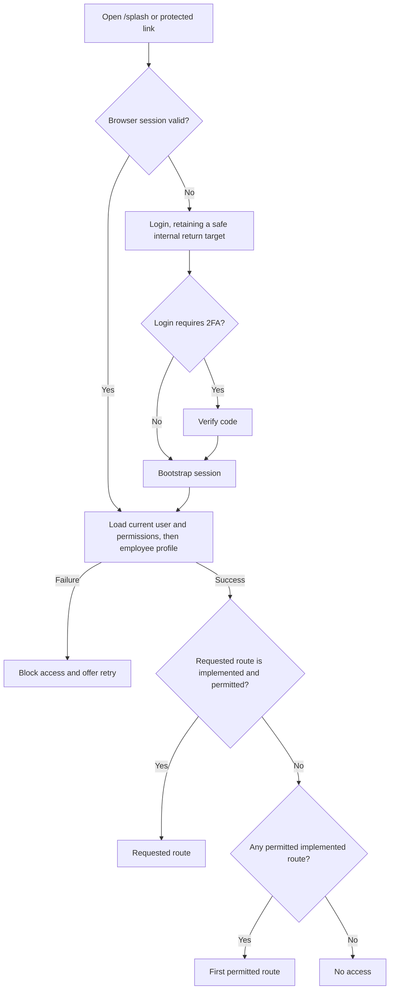

# Browser Authentication Port

## Scope and source of truth

This document describes the React browser authentication slice and its backend contract. Flutter Bomach OS remains the reference for screen layout, copy, and expected workflow. The browser implementation keeps those screens recognizable while applying the shared form, accessibility, responsive, and session-security rules in [interaction-standards.md](interaction-standards.md).

This is the shared Bomach OS browser contract for the default React application and the Services React application mounted at `/services/*`. Flutter, mobile, and other clients retain their existing bearer-token contract. Workspace/Dashboard, Company, HR, and Services protected routes continue to enforce their own existing permission requirements.

## React routes

| Route                | Purpose                                                                | Entry and exit behavior                                                                                                                       |
| -------------------- | ---------------------------------------------------------------------- | --------------------------------------------------------------------------------------------------------------------------------------------- |
| `/splash`            | Verify and bootstrap the browser session.                              | A valid session continues to a permitted return target or first permitted implemented page. An invalid session goes to `/login`.              |
| `/login`             | Email and password sign-in.                                            | A successful login continues to `/splash`; a required code goes to `/two-factor-verify`. A protected deep link is carried through both steps. |
| `/two-factor-verify` | Verify the emailed six-digit code or cancel.                           | Success continues through `/splash` and preserves the requested destination. Cancel returns to Login with that destination preserved.         |
| `/forgot-password`   | Request a reset code.                                                  | Show the same neutral confirmation only after the browser endpoint accepts the request; the user then chooses to continue to the code form.   |
| `/reset-password`    | Verify a code and set a new password.                                  | On server confirmation, clear reset draft data and return to Login. Never sign in automatically.                                              |
| `/biometric`         | Preserve Flutter's biometric entry point on web.                       | Display the browser-unavailable state and provide a password-login link. WebAuthn/passkey login is not part of this contract.                 |
| `/no-access`         | Explain that no implemented route is available to this signed-in user. | This remains protected. Sign out revokes the browser session and returns to Login.                                                            |

The protected route tree includes 40 sidebar destinations and 12 in-scope direct/detail routes listed in [route-inventory.md](route-inventory.md). `/dashboard`, `/company/overview`, and `/hr` now have permission-aware dashboard implementations; the remaining registered routes render the shared metadata-driven Coming Soon page until their Flutter workflows have been reviewed and ported. Permission checks run before protected content is shown.

Two-factor enable/disable belongs in the existing Profile screen, not a separate authentication route. `TwoFactorSettingsPanel` is the reusable profile section. The React Profile route has not yet been ported, so mount this panel when that route is implemented; do not invent a parallel 2FA settings page.

The six Dashboard destinations are included in the protected route manifest, with Dashboard Overview first in fallback order. Therefore an authenticated user can reach the shell immediately; an authorized safe deep link takes precedence. Users with no permitted route see `/no-access` inside the authenticated shell. The current page bodies are placeholders and are not treated as completed ports.

## Session and route flow

`safeInternalTarget` accepts only a same-origin relative path. It rejects external/protocol-relative URLs, backslashes, control characters, auth routes, splash, and no-access. The post-login resolver checks the route registry and current permissions before honoring a return target. Otherwise it chooses the first permitted destination in module registration order, then `/no-access`.

Each protected route is placed below the authenticated route parent and reads its OR-list of required resource/action permissions from the route manifest. An empty list means authenticated-only, matching Flutter's explicit public-to-logged-in gates. The sidebar separately checks the source menu's visible resource set and route permission so it does not display links that lead directly to an access denial. Do not put permissions in client-only storage or treat an unresolved permission response as a denial. Backend authorization remains authoritative. Flutter omits explicit route permission entries for role details, so the React manifest requires the parent Roles page's `roles:list` permission instead of retaining that authenticated-only fallback. Other authenticated-only routes match their explicit Flutter configuration or current source behavior; review these again when their real pages are selected.

Session bootstrap calls `GET /api/v1/auth/me` and then `GET /api/v1/employees/employees/{user_id}`. `/auth/me` is the current-user context: alongside its existing identity fields it returns `role: { id, name } | null` and a `permissions` map containing the signed-in employee role's granted actions. A signed-in user without an employee profile or without an assigned role receives `role: null` and `permissions: {}`; React still requires an employee profile for this employee application. React does not call the ID-based role endpoint or load the full permission catalogue during session bootstrap, so a user does not need `roles.view` merely to learn their own grants. Existing `/auth/me` fields and bearer authentication remain unchanged; the new fields are additive. Flutter's current profile bootstrap reads the employee endpoint instead of `/auth/me`, and the staff mobile `/auth/me` mapper selects known identity fields, so both continue to use their existing contracts.

`GET /api/v1/roles/permissions-map` remains the full system permission catalogue for permission-management interfaces; it is not a user's grants and is not needed to authorize React navigation. `GET /api/v1/auth/capabilities` remains the staff mobile app's boolean feature-flag projection. React does not use it as its permission source because it is a smaller, client-specific projection; currently the backend hardcodes `attendance.view` and `attendance.manage` to `true`, which should be reviewed separately before that endpoint is used for authorization decisions.

React treats a missing or malformed `permissions` field as a bootstrap failure and blocks protected access with retry. A valid empty map means the user has no role grants; the route manifest may still allow routes explicitly marked authenticated-only, and `/no-access` is shown only when no implemented route is permitted. These are the current role's granted resource/action entries, including any `_own` actions; they do not expose the complete permission catalogue or branch IDs. Backend endpoints remain authoritative for every data read and write, including branch and ownership scope. This uses the existing `/auth/me` route; no new session-context endpoint is added.

## Browser endpoint contract

All browser-only endpoints are under `/api/v1/auth/browser/`. Every POST requires the configured exact `Origin` and `X-Bomach-Request: browser` header. JSON responses never include access, refresh, or pending two-factor tokens.

| Method and path          | Request                         | Response/session effect                                                                                                                                                                    |
| ------------------------ | ------------------------------- | ------------------------------------------------------------------------------------------------------------------------------------------------------------------------------------------ |
| `POST /login`            | `{ email, password }`           | `{ success, requires_2fa, detail, user_id? }`; set access+refresh cookies or a pending 2FA cookie. Login failure is generic.                                                               |
| `GET /two-factor/status` | no body                         | `{ success, pending }`; validates the HttpOnly pending cookie without returning its token or user identity. The verification screen waits for this result before showing the code form.    |
| `POST /verify-2fa`       | `{ code }`                      | `{ success, user_id }`; consume the pending session/code and set access+refresh cookies.                                                                                                   |
| `POST /cancel-2fa`       | no body                         | `{ success }`; revoke and clear the pending 2FA session cookie.                                                                                                                            |
| `POST /refresh`          | no body                         | `{ success }`; refresh the access cookie. A rejected refresh returns 401 and clears auth cookies. Refresh token is not rotated, matching the existing backend service.                     |
| `POST /logout`           | no body                         | `{ success }`; revoke refresh/access credentials where present and clear all browser auth cookies.                                                                                         |
| `POST /forgot-password`  | `{ email }`                     | Same neutral `{ success, detail }` for a known or unknown email. The legacy endpoint remains unchanged.                                                                                    |
| `POST /reset-password`   | `{ email, code, new_password }` | `{ success, detail }` on success; use one neutral verification failure for unknown email and invalid/expired code. Reset expires after 10 minutes and increments the user's token version. |

Authenticated session reads use `/api/v1/auth/me` for identity, role summary, and permission grants, plus the current user's employee profile endpoint. Authenticated Company/HR API calls use the same shared Fetch client and access cookie.

Direct visits to `/two-factor-verify` do not assume that a challenge exists. The React page checks the browser status endpoint first, shows the code form only for a valid pending challenge, and offers a retry or Login action if status cannot be checked. If verification returns an expired-session response, it rechecks status and changes to the expired state when the pending cookie is no longer valid.

## Cookies, CSRF, and expiry

- `bomach_access`: `HttpOnly`, host-only, `SameSite=Lax`, `Path=/api/`; expiry is bounded by access JWT expiry (currently 1000 minutes).
- `bomach_refresh`: `HttpOnly`, host-only, `SameSite=Lax`, `Path=/api/v1/auth/browser/`; expiry is bounded by refresh JWT expiry (currently 90 days).
- `bomach_pending_2fa`: `HttpOnly`, host-only, `SameSite=Lax`, `Path=/api/v1/auth/browser/`; expiry is bounded by the pending code/session (10 minutes).
- `Secure` is enabled when Django is not in DEBUG mode. `Domain` is omitted so cookies remain host-only.
- Cookie-authenticated unsafe requests require both the exact configured app origin and the custom request header. Authorization Bearer requests remain compatible with the legacy clients and retain precedence when present.
- Password reset increments `User.auth_token_version`. New access/refresh and 2FA session tokens contain the version; access and refresh validation compare it to the current user version. Older tokens without a version are interpreted as version zero and remain valid until expiry unless reset or otherwise revoked.
- The shared React client uses `credentials: 'include'`, `cache: 'no-store'`, forwards abort signals, coalesces concurrent refresh attempts in the app runtime, and retries each eligible original request no more than once. A failed refresh clears the TanStack Query cache and sends the user to Login with one session-expired notice.
- Login and password-reset request rate limits are deferred for this phase as agreed. Existing one-time-code attempt limits remain active.

Set `BOMACH_WEB_AUTH_ORIGINS` to a comma-separated exact list in each backend environment. Add `https://bomach-os-test.vercel.app` to the test backend and `https://bomach-os.vercel.app` to production, retaining any other intentionally supported browser origins. Local DEBUG defaults include only `http://localhost:5173` and `http://127.0.0.1:5173`. The React Vite dev server proxies `/api` to `BOMACH_API_ORIGIN` (default `http://127.0.0.1:8000`). Vercel Preview and Production use the root project's `/api/*` external rewrite to separately configured HTTPS staging and production origins. API responses receive no-store cache headers.

## Services on the shared host

The React OS Vercel project owns the shared Bomach test and production hosts, `/login`, `/two-factor-verify`, `/forgot-password`, `/reset-password`, session refresh, and the root `/api/*` rewrite. Services remains a separately built and deployed Vite project. The OS project proxies `/services` and `/services/*` to the Services deployment using ordinary external rewrites; the apps do not need to share a Vercel team or account. Both apps appear on the same browser host in the composed experience, so host-only HttpOnly cookies are available to Services' same-origin `/api/v1/*` requests without a token bridge or iframe message.

Services loads the signed-in identity from the existing `/api/v1/auth/me` endpoint, then retains its current `/api/v1/roles/employees/{user_id}` role bootstrap and permission mapping. The backend remains authoritative for each Services read and write. The Services app redirects unauthenticated and expired sessions to the root app's login route with a sanitized `/services/*` return target. The root app honors that target only when the signed-in session has at least one permission corresponding to a real top-level Services destination. Login, two-factor verification, and password-reset navigation retain the target; logout clears the shared cookies. Services' own `RequireAuth` and route permissions still guard its screens.

The Services build produces both a standalone root build and a `/services/` build whose HTML, public files, CSS, and lazy chunks all use the prefix. The standalone deployment keeps its root entry; the shared host serves the prefixed build. The OS rewrite preserves the `/services` prefix, while `/api/*` remains owned by the OS project and `/media/*` routes through its environment-specific backend origin. When Services is mounted on either Bomach host, central login and the app switcher use the current origin, keeping test users on the test host. On a direct Services deployment URL, `VITE_BOMACH_OS_ORIGIN` identifies the root OS host; the supported cross-app session flow returns users to the shared Bomach host.

Release checklist: deploy a prefix-ready build to the existing Services project, then route the OS Preview host to it. Test `/services`, nested-route refreshes, prefixed assets, API routing, login/2FA/reset return targets, refresh, logout, and users with and without Services destination grants. After Preview passes, deploy the matching rewrite to the production OS host. Finance and Marketing remain unlisted until their test destinations and browser-auth readiness are verified; Projects remains deferred until its deployment is identified.

## Form and feedback behavior

- Field validation is shown beside the field; form-level failures remain in one persistent alert.
- Login failure text stays generic. The password is never trimmed; the email is trimmed and validated.
- Requests remain pending until the server responds, prevent duplicate submission, and retain user-entered drafts after failure.
- Forgot-password confirmation is shown only after the browser endpoint responds successfully. Network/server failure stays on the request form with a form-level error.
- Reset success is announced by the Login confirmation after the reset endpoint succeeds. The user signs in with the new password.
- Do not also toast a message already shown as an inline/form/page alert. Profile two-factor success is a small confirmed action and uses a success toast; its failure remains with the section/form.
- API and query modules do not navigate or display feedback.

The auth pages use Flutter-provided Bomach logo and login background assets. Login retains the compact 440px white card and source background overlay; Forgot Password stays right-aligned above Sign In. The full-width outlined Use Biometric control remains below the “or” divider but is natively disabled while backend biometric authentication is unavailable. Forgot/reset remain white centered cards; the two-factor screen uses the Flutter glass treatment and logo tile. The biometric screen keeps a decorative 160px fingerprint graphic, clearly states that biometric sign-in is unsupported in this browser, and offers the password fallback as its only action for direct route visits. Review responsive behavior at 375, 600, 900, 1280, and 1600 CSS pixels plus narrow widths, keyboard access, visible focus, and zoom before calling visual parity complete.

## Verification coverage

### Local browser test identities

- For local React authentication and session-bootstrap smoke tests, use the backend's shared test admin account (`admin@gmail.com`). The backend command [`ensure_test_admin`](../../../bomach_os_backend/user/management/commands/ensure_test_admin.py) is the source of truth for its credential and full-access role; do not duplicate the password in this repository.
- Use this full-access account only against the local development backend and avoid changing business data during auth/UI checks. The current React route registry has no protected Company or HR page, so a successful login currently ends at `/no-access`.
- The backend's [`seed_local_staff_scenario`](../../../bomach_os_backend/user/management/commands/seed_local_staff_scenario.py) provides 19 role-based staff identities (`staff1@gmail.com` through `staff19@gmail.com`) for local role/permission scenarios. It is restricted to the backend's local SQLite database; its shared password is supplied when seeding and is not fixed by the source. Do not run it against staging or production.
- The auth endpoint demo identities in [`test_auth_endpoints.py`](../../../bomach_os_backend/scripts/test_auth_endpoints.py) are a separate API-test fixture with a different password. Use them only when intentionally running that backend script.

Backend tests cover cookie attributes and token-free JSON, deployed Secure cookies, Origin/header rejection, cookie-authenticated reads and protected writes, bearer compatibility, two-factor login/cancellation, refresh/logout, reset privacy and expiry, and global session invalidation. React tests cover typed transport headers/cookies/no-store behavior, refresh coalescing and one retry, session-expiry notification, safe/deep-link navigation, login draft/generic error behavior, forgot-password confirmation, two-factor return-target preservation, password reset confirmation, biometric fallback, and representative axe checks.

The local browser review verified the Forgot Password request through the Vite proxy to Django, generic invalid-login feedback, the expired two-factor response, biometric navigation and password fallback, and the reset-request-to-code-form flow using a synthetic `.invalid` address. A successful sign-in with the backend's shared test admin was also verified through React session bootstrap; it reached the expected `/no-access` screen because no protected Company/HR page is registered yet, then the session was signed out. Auth screens were visually reviewed at 375px and 1280px; card fit and horizontal overflow were measured at 320, 375, 600, 900, 1280, and 1600px, with extra short-height checks at 320×568 and 375×667. Keyboard order was checked on the auth forms. No overflow was found.

A password change was not submitted in the browser because it requires a reset OTP. The Profile two-factor panel still needs the Profile surface to be ported and mounted. Vercel preview cookie round-trip, deployed routing, authenticated-response cache behavior, browser zoom, and screenshots at every target width remain deployment/browser checks; do not mark them complete until checked against a configured preview and account session.
