# Flutter Route Reachability and Navigation Audit

**Audit date:** 2026-10-16  
**Source:** current local checkout at `../bomach_os`  
**Status:** static source audit; the Flutter checkout is read-only and contains local uncommitted work.

## Purpose

This audit documents the current Flutter sidebar, all registered route families, page-to-page navigation, routes that are redirected or blocked, and page classes that have no active route or runtime caller. The exhaustive page-by-page route and widget list is in [route-inventory.md](route-inventory.md); this document adds the connection and reachability map.

“Reachable” means registered and navigable in the current source configuration. Authentication, permissions, record IDs, and route data can still affect what a particular user can open.

## Reachability terms

| Term | Meaning |
| --- | --- |
| **Sidebar** | A destination in `menu_structure.dart`; children are permission-filtered. |
| **In-app link** | A source button, row, notification, or embedded-app bridge navigates to it. |
| **Deep-link only** | Registered and directly openable by URL, but no app-side caller was found in the reviewed source. |
| **Data-dependent** | Needs a record ID, query parameter, or `state.extra`; without it the intended record cannot be loaded. |
| **Redirected** | The router redirects before the mapped page widget is built. |
| **Blocked** | Permission service denies the route before its page is shown. |
| **Unregistered** | A path constant or widget exists, but the path is not registered; typing it reaches “Page not found”. |
| **Orphan candidate** | A screen-like Dart class has no route or runtime reference found by static scan. It is a review candidate, not a deletion recommendation. |

An unlinked **Deep-link only** page is still reachable. An **Orphan candidate** is not reachable through the active router or a runtime caller found by the scan.

## Counts

Flutter uses a `StatefulShellRoute.indexedStack`; every `_dashboardRoutes` entry is a dashboard-shell branch. The six sidebar headers contain **124 destination leaves**. The router has **196 dashboard route-map paths** and the route outcomes divide as follows:

| Source outcome | Count | Notes |
| --- | ---: | --- |
| Flutter page routes | 107 | Pages, aliases, and multiple routes resolving to the same page class. |
| Embedded standalone-app routes | 82 | Services 17, Marketing 37, Finance 28; some use a Flutter wrapper. |
| Retired redirects | 7 | Redirect to `/crm/clients` before mapped widgets render. |
| **Dashboard route-map paths** | **196** | 107 + 82 + 7. |
| Auth/bootstrap routes | 6 | Outside the dashboard shell. |
| Parameterized detail patterns | 3 | Role, estate, and estate-performance IDs. |

The sidebar itself has **58 Flutter destinations** and **66 embedded-app destinations**. The other 72 dashboard paths comprise 49 additional Flutter routes, 16 additional embedded-app routes, and 7 retired redirects. Counts are path entries, not unique screen designs. Seven Marketing paths outside the sidebar are hard-blocked, leaving 75 embedded route targets that can render subject to ordinary access checks.

### Complete sidebar route lists

- [Workspace — Dashboard and Company](route-inventory.md#workspace)
- [People — HR/Admin](route-inventory.md#people)
- [Operations — Operations, Services, and Events](route-inventory.md#operations)
- [Revenue — Marketing & Sales, CRM, and Finance & Accounting](route-inventory.md#revenue)
- [Insights — Analytics & Insights](route-inventory.md#insights)
- [Compliance — Legal & Compliance and Security](route-inventory.md#compliance)

The inventory names every leaf’s path and target widget, or the standalone app and child path.

## Navigation map

```mermaid
flowchart TD
  Splash["/splash"] -->|auth restored| Pending["Pending URL or first permitted route"]
  Splash -->|signed out| Login["/login"]
  Login --> Forgot["/forgot-password"]
  Forgot --> Reset["/reset-password"]
  Login --> Bio["/biometric"]
  Login --> TwoFA["/two-factor-verify"]
  Login -->|success| Dashboard["/dashboard"]
  Bio -->|success| Dashboard
  TwoFA -->|success| Dashboard

  Workspace["Workspace sidebar"] --> Dash["Dashboard pages"]
  Workspace --> Company["Company pages"]
  People["People sidebar"] --> HR["HR/Admin pages"]
  Operations["Operations sidebar"] --> Ops["Operations pages"]
  Operations --> Services["Services standalone app"]
  Operations --> Events["/events"]
  Revenue["Revenue sidebar"] --> Marketing["Marketing standalone app"]
  Revenue --> CRM["/crm/clients"]
  Revenue --> Finance["Finance standalone app"]
  Insights["Insights sidebar"] --> Analytics["/analytics"]
  Compliance["Compliance sidebar"] --> Legal["Legal pages"]
  Compliance --> Security["Security pages"]

  Dash -->|attendance CTA| EmployeeAttendance["/employee/attendance"]
  EmployeeHome["/employee"] --> Directory["/employee/directory"]
  EmployeeHome --> Performance["/employee/performance"]
  EmployeeHome --> EmployeeAttendance
  EmployeeHome --> Training["/employee/training"]
  HR -->|quick actions| HRChildren["Employees, attendance, calendar, recruitment, leave, performance, training, audit"]
  Employees["/hr/employees"] -->|nested Navigator| EmployeeProfile["EmployeeProfile"]
  Attendance["/hr/attendance"] -->|nested Navigator| History["AllAttendanceHistoryPage"]
  Company -->|row| BranchDetail["BranchDetailPage (in-page)"]
  Company -->|role action| RoleDetail["/company/roles/:roleId"]
  Company -->|roles action| OrgChart["/company/org-chart"]
  Ops -->|project row| ProjectDetail["EachProjects"]
  Ops -->|task row| TaskDetail["/services/task/detail"]
  Ops -->|worksite row| WorksiteDetail["WorksiteDetailPage"]
  WorksiteDetail --> Engineering["EngineeringSiteReportsPage"]
  WorksiteDetail --> Survey["SurveySiteReportsPage"]
  Ops -->|contract row| ContractDetail["/operations/contract/detail"]
  Legal -->|record action| LegalDetail["DetailsViewPage (in-page)"]
```

The diagram shows source-confirmed connections, not every control inside every page. The route inventory is the exhaustive route target list.

## Source-confirmed navigation connections

| From | To | How it connects |
| --- | --- | --- |
| `/splash` | Pending requested URI or first permitted route; `/login` if signed out | Router remembers an internal URI while auth initializes. |
| `/login` | `/forgot-password`, `/biometric`, `/two-factor-verify`; `/dashboard` after auth | Login can start 2FA. The guard can redirect super-admin users from the employee dashboard to `/company`. |
| `/forgot-password` | `/reset-password` | In-app `context.push`. |
| Dashboard attendance CTA | `/employee/attendance` | In-app `context.go`. |
| `/employee` | `/employee/directory`, `/employee/performance`, `/employee/attendance`, `/employee/training` | Four explicit employee-home actions. |
| `/hr` | `/hr/employees`, `/hr/attendance`, `/hr/attendance-calendar`, `/hr/job-post`, `/hr/leave-request`, `/hr/performance-review`, `/hr/training-program`, `/company/audit-log` | HR landing quick actions. `/hr` is separate from the HR/Admin sidebar child routes. |
| `/hr/employees` | `EmployeeProfile` | Nested `Navigator` push with the selected employee. `/hr/employees/profile` is also separately registered. |
| `/hr/attendance` | `AllAttendanceHistoryPage` | Nested `Navigator` push; not a GoRouter path. |
| Sidebar notification bell | `/company/broadcast` | Opens Broadcast on its Notifications tab. |
| Leave notification | `/hr/leave-request?request_id=<id>` or `/hr/leaves?request_id=<id>` | Type-dependent destination; the route builder reads `request_id`. Other notification types open a detail dialog. |
| `/company/branch` | `BranchDetailPage` | Nested `Navigator` push, not a GoRouter path. |
| `/company/roles` | `/company/org-chart`; `/company/roles/:roleId` | Org-chart and role-detail actions. Role detail links back to `/company/roles`. |
| `/operations`, `/works/projects` | `EachProjects` | Project selection pushes the detail widget; `/works/projects/detail` is also registered. |
| `/works/tasks` | `/services/task/detail` | `context.push` carries the task in `state.extra`; data-dependent. |
| `/works/contracts` | `/operations/contract/detail` | `context.push` carries the contract in `state.extra`; data-dependent. |
| `/works/worksite` | `WorksiteDetailPage` | Worksite row pushes the page; `/operations/worksite/detail` is also registered. |
| `WorksiteDetailPage` | Engineering/Survey site reports | Nested pushes pass worksite/project IDs. The report pages also have their own routes. |
| `/dashboard/my-reports` | Survey and Engineering site reports | Nested pushes when report actions are available. |
| Legacy Flutter Services pages | Service/property/estate/survey details | `/services-property` → `/services/detail`; real-estate and estate-management rows → `/services/estate/:estateId`; `/services/property` → `/services/property/detail`; `/services/land-survey` → `/services/land-survey/detail`. |
| Legal Contracts, Compliance, Cases, Audits | `DetailsViewPage` | Nested `Navigator` pushes. The four legal routes reuse `LegalsPage` with different selected tabs. |
| Marketing iframe | `/marketing/new-lead` | The iframe bridge validates message origin/source and then navigates the Flutter host. Other child routes can remain inside Marketing. |

### Non-sidebar route ingress classification

The route-by-route target widgets are in [route-inventory.md](route-inventory.md#registered-routes-not-linked-as-sidebar-destinations). This table classifies every non-sidebar route by whether the Flutter host has an explicit incoming navigation source. “Direct URL” means the GoRouter path itself has no source-controlled host caller found in the reviewed `lib/` scan; it can still render if the route guards pass. A page class can also be pushed in-page without calling its separately registered GoRouter path.

| Route group | In-app source or URL-only status |
| --- | --- |
| `/hr` | Direct URL entry. Once open, its quick actions navigate to the HR routes listed above. |
| `/hr/employees/profile` | Employee profile widget is pushed from `/hr/employees`; the path itself has no matching `context.go/push` caller. The row push supplies the employee object. |
| `/employee` | Direct URL entry; it links onward to the four employee routes below. |
| `/employee/directory`, `/employee/performance`, `/employee/attendance`, `/employee/training` | Linked from `/employee`; attendance also has a Dashboard CTA. |
| `/hr/associates` | Direct URL entry. |
| `/company/roles/detail` | Direct URL compatibility route; needs an integer `state.extra`, so a plain URL shows the unavailable state. The usable role link is `/company/roles/:roleId`. |
| `/company/roles/:roleId` | Linked by the Roles page with an ID. |
| `/company/enugu` | Direct URL entry. |
| `/works/projects/detail` | The `EachProjects` page is pushed from Operations/Projects lists; no source call to this exact GoRouter path was found. |
| `/operations/projects/detail`, `/operations/task/detail`, `/operations/timeline/detail` | Direct URL entries; no host navigation caller found. |
| `/operations/worksite/detail` | Direct URL route; the same `WorksiteDetailPage` is pushed from the Worksite list without using this path. |
| `/operations/contract/detail` | Linked from Contracts with the contract in `state.extra`. |
| `/services/real-estate` | Direct URL entry; estate rows link onward to `/services/estate/:estateId`. |
| `/services/service-order` | Direct URL entry. |
| `/services/land-survey` | Direct URL entry; links onward to `/services/land-survey/detail`. |
| `/services/real-estate/detail` | Direct URL entry; no source caller found. |
| `/services/land-survey/detail` | Linked from `/services/land-survey`. |
| `/services/task/detail` | Linked from the sidebar Tasks page with a task object in `state.extra`. |
| `/services-property` | Direct URL entry; links onward to `/services/detail`. |
| `/services/detail` | Linked from `/services-property`. |
| `/services` | Direct URL entry to the legacy Flutter Services Dashboard; the current Services sidebar opens the standalone app instead. |
| `/services/land-survey-calculator`, `/services/services-calculator` | Direct URL entries; no host navigation caller found. |
| `/services/property` | Direct URL entry; property rows link onward to `/services/property/detail`. |
| `/services/property/detail` | Linked from `/services/property`. |
| `/services/estate-management` | Direct URL entry; estate rows link onward to `/services/estate/:estateId`. |
| `/services/estate/detail` | Compatibility detail route; expects an `Estate` object in `state.extra`. ID-based in-app links use `/services/estate/:estateId`. |
| `/services/estate-performance` | Direct URL compatibility route; expects an `Estate` object. The registered ID form is `/services/estate-performance/:estateId`; no source caller for that form was found. |
| `/services/payment-approval`, `/services/clients`, `/services/clients/upload`, `/services/generate-invoice`, `/services/leads`, `/services/invoices` | Direct URL entries; no host navigation caller found. |
| `/finance`, `/finance/invoice`, `/finance/payment`, `/finance/expense`, `/finance/contract-payment`, `/finance/budget` | Direct URL aliases into the standalone Finance app; no host navigation caller found. |
| `/marketing` | Linked from the non-sidebar `/marketing-crm` page; this route is a Flutter wrapper around the standalone Marketing app. |
| `/marketing/reports`, `/marketing/workdesk`, `/marketing/integrations` | Direct URL entries into the standalone Marketing app; no host navigation caller found. |
| `/marketing/funnel-audit`, `/marketing/retention`, `/marketing/role-governance`, `/marketing/audit-log`, `/marketing/compliance`, `/marketing/design`, `/marketing/whatsapp` | Blocked by the hard-coded deny list; direct URL does not render these destinations. |
| `/marketing/lead/detail`, `/marketing/campaign/detail`, `/marketing/site/detail` | Direct URL entries; no host navigation caller found. |
| `/marketing-crm` | Direct URL entry; its page links to `/crm/clients` and `/marketing`. |
| `/workspace`, `/workspace-dashboard`, `/analytics/revenue`, `/analytics/projects`, `/analytics/performance`, `/analytics/branch-performance` | Direct URL entries; no host navigation caller found. |
| `/client/portal`, `/client/portal/communications`, `/client/portal/documents&sharing`, `/client/portal/analytics`, `/crm/leads`, `/crm/interactions`, `/crm/analytics` | Retired redirects to `/crm/clients`; the mapped widgets are not rendered. |

The **six auth/bootstrap paths** and **three parameterized patterns** are listed separately under “Additional shell routes” in the route inventory. Their auth and data behavior is documented above.

## Registered paths that do not currently show their mapped page

### Retired redirects

These paths redirect to `/crm/clients` before the registered widget is built:

- `/client/portal`
- `/client/portal/communications`
- `/client/portal/documents&sharing`
- `/client/portal/analytics`
- `/crm/leads`
- `/crm/interactions`
- `/crm/analytics`

CRM Clients remains active at `/crm/clients`. A `ClientDetailsMobileScreen` push exists under the old Client Portal flow, but its parent routes are retired, so it is not normally reachable through the current router.

### Hard-blocked Marketing paths

`PermissionService._disabledMarketingRoutes` rejects these even when requested directly:

- `/marketing/funnel-audit`
- `/marketing/compliance`
- `/marketing/retention`
- `/marketing/whatsapp`
- `/marketing/design`
- `/marketing/role-governance`
- `/marketing/audit-log`

The 27 Marketing sidebar destinations are different paths and use the ordinary permission filtering.

### Data-dependent details

- `/company/roles/detail` expects an integer `state.extra`; durable links use `/company/roles/:roleId`.
- `/services/estate/detail` expects an `Estate` in `state.extra`; durable links use `/services/estate/:estateId`.
- `/services/estate-performance` expects an `Estate` in `state.extra`; durable links use `/services/estate-performance/:estateId`.
- Task and contract detail routes receive records in `state.extra`; a direct URL does not recreate that in-memory record.
- `/hr/leaves` and `/hr/leave-request` optionally accept `?request_id=<id>` to focus a specific request.

The role/estate builders show `RoleDetailUnavailable` or `EstateDetailUnavailable` if required detail input is missing. ID-based estate routes fetch the estate before rendering the detail page.

## Path constants absent from the active route registry

These constants are not among the 196 dashboard paths, auth paths, or parameterized patterns:

| Path | Current status |
| --- | --- |
| `/works` | Unregistered; no active route page. |
| `/hr/employees/add` | Unregistered; no active route page. |
| `/hr/clock-in` | Unregistered; router entry is commented out. |

Typing one of these paths reaches the router’s “Page not found” error builder. Do not count these constants as active routes.

## Screen-like classes with no active route or runtime caller found

Static scan of the Flutter `lib/` source found these screen-like classes without a route registration or runtime reference. This is a review list, not permission to remove them; they may be stale, future work, or owned by another app boundary.

| Widget class | Source file | Finding |
| --- | --- | --- |
| `AuthorityLimitsPage` | `lib/pages/company/authority_limits.dart` | No active route or runtime reference found. |
| `ContractPaymentPage` | `lib/pages/finance/contract_payment.dart` | No active route or runtime reference; Finance sidebar uses its standalone app. |
| `DashboardPage` | `lib/pages/analytics/performance.dart` | No active route or runtime reference; `/analytics/performance` maps to `PerformanceAnalytics`. |
| `DepartmentPage` | `lib/pages/hr/department.dart` | No active route or runtime reference; `/company/department` maps to `DepartmentsUnitsPage`. |
| `ExpensesPage` | `lib/pages/finance/expenses.dart` | No active route or runtime reference; Finance destinations are embedded. |
| `InvoicePage` | `lib/pages/finance/invoice.dart` | No active route or runtime reference; Finance destinations are embedded. |
| `MarketingDashboard` | `lib/pages/marketing/dashboard/marketing_dashboard.dart` | No active Bomach OS route or runtime reference found. |
| `PaymentsPage` | `lib/pages/finance/payments.dart` | No active route or runtime reference; Finance destinations are embedded. |
| `PayrollPage` | `lib/pages/hr/payroll.dart` | No active route or runtime reference. |
| `TaskDetailPage` | `lib/pages/operations/operation_task_detail.dart` | No active route or runtime reference; the task route uses a different `TaskDetail` widget. |

These three classes were referenced by tests but not by the runtime `lib/` scan:

| Widget class | Source file | Finding |
| --- | --- | --- |
| `BudgetPage` | `lib/pages/finance/budget.dart` | Test-only reference; no active route/runtime reference. |
| `ClientsDatabasePage` | `lib/pages/client/clients_database.dart` | Test-only reference; no active route/runtime reference. |
| `FinancePage` | `lib/pages/finance/finance.dart` | Test-only reference; no active route/runtime reference. |

By contrast, `BranchDetailPage`, `AllAttendanceHistoryPage`, `DetailsViewPage`, `EachProjects`, `WorksiteDetailPage`, Engineering/Survey report pages, and `EmployeeProfile` are reachable through registered pages or nested `Navigator` pushes even when they are not sidebar entries themselves.

## Guard behavior affecting reachability

- During auth initialization the router shows `/splash` and remembers a requested URI. Signed-out users go to `/login`; after auth, the URI is resumed or the first permitted route is selected.
- Logged-in users are redirected from public auth routes. Logout returns to `/login`.
- Retired redirects run before page construction. The seven Marketing hard blocks run before normal route permission checks.
- Most route requirements are in `lib/src/constants/permissions.dart`. A mapped route passes if the user has **any** listed permission. `/hr/leave-request` uses an explicit permission check.
- `canAccessRouteTyped` permits a logged-in user when a route has no requirement-map entry. Known examples include `/dashboard/my-target-reports`, `/marketing-crm`, `/company/roles/detail`, and ID-based detail paths whose full URL is not an exact map key. The source comments describe this as a fail-open default.
- Sidebar children, pinned routes, and search results are permission-filtered. An expandable parent remains visible when at least one child passes.
- Super-admin users are redirected from configured employee-dashboard paths to `/company`.
- Unregistered paths reach the error builder displaying “Page not found”.

## Audit limits and port implications

This is a static audit of the local Flutter checkout. The Edge test deployment showed an expired-token `401` on the employee route during inspection, so its data and account-specific access were not verified. The local Flutter checkout also contains uncommitted changes and may not match the deployed build.

The orphan scan looks for conventional screen-like classes and Dart references. It cannot rule out reflection, generated entry points, runtime configuration, or links inside an external iframe. Verify candidates against product usage before removing anything. No Flutter code was changed and no tests/builds were run for this documentation audit.

Use [route-inventory.md](route-inventory.md) as the complete path/widget checklist and this audit for connections and reachability. The agreed React implementation scope remains Company, HR/Admin, and the shared shell; this broader inventory does not expand that scope by itself.

## Source files reviewed

- `../bomach_os/lib/src/app_routes/menu_structure.dart`
- `../bomach_os/lib/src/app_routes/app_route_constants.dart`
- `../bomach_os/lib/src/app_routes/dashboard_route_paths.dart`
- `../bomach_os/lib/src/app_routes/app_router.dart`
- `../bomach_os/lib/src/app_routes/detail_fallbacks.dart`
- `../bomach_os/lib/src/constants/permissions.dart`
- `../bomach_os/lib/src/services/permission_service.dart`
- `../bomach_os/lib/pages/company/`, `dashboad/`, `employee/`, `hr/`, `operations/`, `services/`, `legal/`, `marketing/`, `clients_portal/`, and `auth/`
