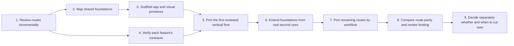

# Porting Plan

## Current position

The global route/reachability pass is complete. The first detailed route review is underway, and the React foundation has started. The sibling Flutter checkout remains the visual and behavior reference.

- Completed: global sidebar and route inventory, including route targets and standalone-app boundaries; see [route-inventory.md](route-inventory.md).
- Completed: route reachability, redirects, unregistered paths, and orphan candidates; see [flutter-reachability-audit.md](flutter-reachability-audit.md).
- Agreed: React + TypeScript + Vite; TanStack Router, Query, and Form; Zod; Tailwind; one typed Fetch client; shared error and feedback behavior; no Redux/RTK Query for the current scope.
- In progress: first detailed in-scope route review, Company Profile; see [company-hr-screen-review.md](company-hr-screen-review.md). Its source behavior is recorded; deployed populated states remain unverified because the test session expired.
- Completed: shared foundation and extension map; see [shared-foundations-plan.md](shared-foundations-plan.md).
- Completed: Vite/React/TypeScript scaffold, Flutter-derived global tokens, and first shared visual/feedback foundation slice. The local preview is temporary; there is no product shell, route, auth, or live API integration yet.
- Not started: the remaining 31 Company/HR screen reviews, backend/auth contract verification, protected shell, or feature-page implementation.

## Scope disposition

| Route group | Initial port decision | Work to do |
| --- | --- | --- |
| Company — 15 sidebar destinations | **In scope** | Port Flutter-owned screens and their required navigation, permissions, API behavior, forms, and shared states. |
| HR/Admin — 17 sidebar destinations | **In scope** | Same parity requirements; includes the employee, attendance, leave, recruitment, training, compensation/benefits, and performance workflows. |
| App shell, auth/session, routing, permissions, shared UI and feedback | **In scope as required foundation** | Implement only the shared behavior needed to host the agreed routes and preserve existing links. |
| Services, Marketing, Finance sidebar destinations | **Preserve as separate apps** | Keep current standalone-app launch/embedding and identity-sharing boundaries. Do not rewrite their pages. |
| Workspace Dashboard — 6 destinations | **Not decided for first cut** | Decide whether the React shell needs all six pages or only a landing/return route. Do not assume all six are included. |
| Operations, Events, CRM Clients, Analytics, Legal & Compliance, Security | **Outside initial port scope** | Documented for awareness; implement only if the product scope is later expanded. |
| Legacy Flutter Services pages and non-sidebar detail routes | **Outside initial port scope** | Do not migrate by default. Retain only routes needed for compatibility or explicit navigation decisions. |
| Seven retired Client Portal/CRM routes | **Do not port as pages** | Preserve their redirect to CRM Clients if those legacy URLs must continue working. |
| Seven blocked Marketing routes | **Do not port** | They are blocked in the Flutter host and belong to the separate Marketing app. |
| Three unregistered path constants and 13 orphan candidates | **Do not treat as product routes** | Keep out of the parity checklist unless current use is verified; this is not a cleanup/deletion request. |

The initial page checklist is therefore **32 sidebar destinations (15 Company + 17 HR/Admin)**, plus the minimum shared shell/auth/permission/standalone integration needed to host them. The complete app-wide inventory is broader and does not expand implementation scope by itself.

## Roadmap at a glance

The shared visual and feedback foundation slice is implemented and described in [shared-foundations-plan.md](shared-foundations-plan.md). Continue the route workbook in [company-hr-screen-review.md](company-hr-screen-review.md) while resolving the initial pilot choice and protected-route contracts. Do not create a speculative shell: the Workspace Dashboard scope, initial landing route, navigation/permission input, and browser session contract still affect that work.

## Working method

The port is a careful, incremental implementation authored by Codex with the user making product and behavior decisions. Do not attempt a one-shot rewrite. Work in small, reviewable slices and keep this plan and the interaction standards current.

The current Flutter checkout remains the visual and behavior reference. The Service Operations app is a separate reference for React architecture and feedback conventions. Do not edit either sibling repository as part of ordinary port work.

## Phase 0 — Route review, continued alongside foundation work

**Status: global route audit complete; in-scope screen review remains.** The global route registry, sidebar map, current renderer, redirects, disabled paths, unregistered constants, and orphan candidates are documented in [route-inventory.md](route-inventory.md) and [flutter-reachability-audit.md](flutter-reachability-audit.md).

Now inspect each of the 15 Company and 17 HR/Admin sidebar destinations against the current Flutter source. Reconcile the local source with the deployed test build where access permits. The prior test deployment inspection hit an expired token, so route data and account-specific permissions remain unverified there.

For each route or screen, record:

- Existing route path and destination.
- Owning module and whether it belongs to the Flutter app or a standalone application.
- User roles and permission resource/action required for entry and each major action.
- Main data, filters, actions, dialogs, uploads, and dependent lookups.
- Current loading, empty, error, success, and mutation-pending behavior.
- API service methods, request/response shapes, and backend contract evidence.
- Responsive layout and screenshots at 375, 600, 900, 1280, and 1600 CSS pixels; also record 320px/zoom behavior or a breakpoint-edge check when the screen needs it. Note how navigation, page actions, tables, forms, overlays, and state messages adapt without losing essential content. Apply [the responsive usability standard](interaction-standards.md#responsive-layout-and-usability), including documented Flutter/content-driven exceptions.
- Links to related screens and return-navigation behavior.
- Browser-specific capabilities such as camera/liveness, geolocation, file upload, export, or notifications.

Do not infer the number of screens from Dart file counts. Controllers, models, and dialogs are separate files. Use the menu and router to define scope, then trace in-page pushed screens and dialogs as part of their parent workflow. The audit's unregistered paths and orphan candidates are not automatically pages to port.

## Phase 1 — Resolve protected-route implementation blockers

Before implementing authentication, configuring protected routes, or calling live APIs, verify:

- Which auth base URL, login, refresh, current-user, and permission contracts the target must use.
- How Company and HR share a session with the separately owned apps.
- How the React Bomach shell preserves standalone-app launch, return, and session-sharing behavior.
- API endpoint and permission contracts against current code and backend documentation.
- Browser support for each Flutter capability in the route inventory.
- Which existing fonts, images, icons, and chart designs must be carried into the new branch.

Also decide whether the six Workspace Dashboard destinations belong in the first cut, and which route is the initial post-login landing page. Do not reopen the agreed framework or state-management choices unless source evidence presents a concrete conflict.

Record decisions and owners in the relevant document before coding dependent flows. Never put tokens in URL query parameters. Do not implement against guessed endpoint shapes or reuse unrelated standalone-app auth assumptions.

## Phase 2 — Scaffold the small shared React foundation

**Status: visual foundation complete; app composition pending.** The root Vite/React/TypeScript setup, lockfile, Poppins font, semantic tokens, shared controls, feedback states, dialog, tooltip, toast host, and local component preview are in place. Continue only with components needed by reviewed routes; defer auth, live API calls, and permissions until their contracts are verified.

The route review and shell-independent visual foundation can proceed incrementally. Keep protected routes and live API behavior behind unresolved contract boundaries until auth/session and API decisions are verified:

- Create the Vite React TypeScript application at the repository root.
- Add the agreed TanStack, Zod, Tailwind, and quality toolchain.
- Establish Bomach visual tokens from the Flutter source.
- Build the product shell after the landing route, Workspace scope, auth/session bootstrap, and permission input are reviewed; add API/auth/permission wiring only against verified contracts.
- Keep the implementation modular; do not build a generic platform framework larger than the pages need.

Complete the provider/router entry points when the first real route is ready. Add lint/format and any verification tooling as a separate small setup slice. The initial package manager and resolved dependencies are recorded in `package-lock.json`. Do not build feature folders or generic components for screens not yet reviewed.

## Phase 3 — Port shared shell and one representative flow

Port the application shell, navigation, and one representative Company or HR workflow. Recommended pilot: the Employees list/profile plus one verified employee create/edit form, if that is the current workflow. This should exercise list/detail navigation, a form, permissions, API loading, a backend failure, and confirmed success. If the employee form does not cover those patterns, choose a reviewed Company/HR workflow that does. The pilot is not selected yet; the employee route and form need a detailed source pass, and the Company Profile review needs its populated state and unresolved save/permission behavior settled.

Build the first API client, auth/session adapter, permission bootstrap, error presentation, form primitives, loading/empty/error states, and Bomach design tokens only as the pilot requires them. Compare it with Flutter at the five agreed viewport widths and any relevant breakpoint edges. Adjust shared pieces before repeating patterns across routes.

## Phase 4 — Port routes by vertical slice

Port one workflow at a time. For each slice:

1. Confirm the reference route, interaction, permission, API contract, and screenshots.
2. Implement query/API types and mapping where needed.
3. Implement the screen and its shared-state behavior.
4. Compare populated and non-populated states, form correction, success, and failure paths.
5. Review responsive behavior and navigation at the five agreed viewport widths, plus any breakpoint edge where that workflow changes layout. Check narrow-screen content order, table access, form validation, overlay fit, and error/success visibility.
6. Record deviations and get the user's decision before changing the product behavior.

Group pages only when they share real behavior. Avoid giant files and avoid abstracting a component before there is a clear reuse case.

Recommended implementation order after the pilot:

1. **HR foundations:** Employees/profile, attendance, and work calendar. These establish person/detail, table, date, and permission patterns.
2. **HR workflows:** Recruitment, leave and leave requests, training, loans, and benefits. Review forms and approvals individually.
3. **HR performance:** Performance, work reports, monthly scorecard, awards, leaderboard, evaluation, disciplinary process, and performance engine.
4. **Company core:** Company Profile, Branch (including its in-page detail), Departments & Units, and Assets.
5. **Company governance:** Roles & Permissions (including ID details), Org Chart, Board, Broadcast, approval workflows, Workspace Approvals, KPI, OKR, Compliance Dashboard, Knowledge Base, and Audit Log.

This is a dependency-based starting order, not a requirement to finish every route in one group before discussing changes. Use the screen review and shared API dependencies to adjust it with the user.

## Phase 5 — Review integration and cutover separately

When all in-scope routes have parity:

- Review authentication expiry, permissions, deep links, standalone-app launch, and return behavior end to end.
- Review accessibility and browser-specific capabilities.
- Confirm production configuration and SPA route fallback in a non-production target.
- Compare all in-scope screens at the agreed viewports.
- Plan hosting cutover as a separate user-visible decision. Do not change the Flutter deployment target as part of local port development.

## How we will work on each route

Use the same small cycle for each route or tightly related workflow:

1. **Inspect:** open the Flutter route at all five agreed viewport widths; capture its normal state and relevant responsive form/dialog states. Check the source's own breakpoint edges when they differ from the shared cutovers.
2. **Trace:** record incoming/outgoing links, permission names, endpoint methods, payloads, validation, and server errors from current source/backend evidence.
3. **Agree:** confirm any ambiguity or behavior difference with the user before implementation.
4. **Implement:** add the feature API/query/types and page under its module; use shared error/form/feedback patterns while preserving the Flutter layout.
5. **Review:** compare UI, state transitions, responsive behavior, and navigation against Flutter. Keep each slice small enough to review.
6. **Record:** update the route workbook, standards, and decision log when a verified behavior or exception changes.

Finish and review a route slice before starting a broad rewrite of the next group. Do not batch-create placeholder pages for all routes.

## What is deliberately not part of the first implementation

- Porting the standalone Services, Marketing, or Finance page content.
- Porting Operations, Events, CRM, Analytics, Legal, or Security pages just because they appear in the global Flutter inventory.
- Recreating retired routes as active screens, bypassing the current Marketing deny list, or adding pages for path constants absent from the router.
- Porting orphan-candidate Dart classes without evidence that users currently rely on them.
- Redesigning screens, changing route names unnecessarily, changing backend business rules, or moving production hosting before parity review.

## Route completion criteria

A route is ready for review when:

- Its route path and navigation match the agreed inventory.
- Its layout, copy, typography, colors, spacing, icons, overlays, and responsive behavior match the Flutter reference or have a documented, reviewed web adaptation.
- It remains usable at 375, 600, 900, 1280, and 1600 CSS pixels; narrower/zoomed use and breakpoint boundaries are checked where relevant. No essential content or action is clipped, hidden, or unreachable.
- It uses the verified API contract and correct permission names.
- Loading, empty, populated, page/section error, pending mutation, and success states are intentional.
- Forms preserve drafts on failure, map server field errors, prevent duplicate submission, and show success only after backend confirmation.
- Related standalone modules still open through the agreed boundary.
- Any behavior difference is recorded and approved by the user.

## Open decisions to resolve during Phase 0

- Reconcile the first-pass route inventory with the deployed test build; complete Company and HR route details, ownership boundaries, deep links, and navigation behavior.
- Confirm whether all six Workspace Dashboard routes belong in the first cut and select the post-login landing/return route for the React shell.
- Auth and operations origins, environment selection, and backend login/refresh/current-user/permission/error contracts.
- Whether API DTOs should be handwritten from verified contracts or generated from OpenAPI, and where runtime response validation is warranted.
- Browser session sharing, standalone-app launch, return-navigation, and any embedded-app message contract.
- Browser parity for camera/liveness, location, uploads/downloads, exports, and notifications.
- Exact assets, icons, charts, and screen measurements needed for visual parity; use the responsive cutovers and review widths documented in the shared foundation. Select icon/chart libraries only if required.
- Route-specific query freshness, retry, invalidation, and optimistic-update behavior.
- Workflow-specific exceptions to form validation timing and shared feedback rules.
- Exact dependency versions and package-manager choice at scaffolding; whether Storybook is useful for the actual component inventory.
- Hosting target and SPA fallback for a later non-production deployment; production cutover remains a separate decision.

The current state-management direction is settled for planning: TanStack Query for server state, TanStack Form for form drafts, URL state for navigable filters, and local React state for transient UI. Redux/RTK Query are not part of the initial stack unless discovery uncovers a concrete client-only state need and the user agrees to revisit the choice.

## Progress tracking

Update this document when phases complete. Track route-level review results in route-inventory.md or a linked workbook before implementation. Keep reachability findings in flutter-reachability-audit.md, confirmed behavior in interaction-standards.md, and confirmed technical decisions in architecture.md and decisions.md.
