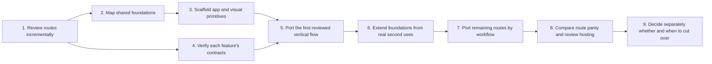

# Porting Plan

## Current position

The global route/reachability pass and authenticated shell are complete. The sibling Flutter checkout remains the visual and behavior reference. My Work Reports is now a ported transactional workflow; most other protected routes remain placeholders pending individual route reviews.

- Completed: global sidebar and route inventory, including route targets and standalone-app boundaries; see [route-inventory.md](route-inventory.md).
- Completed: route reachability, redirects, unregistered paths, and orphan candidates; see [flutter-reachability-audit.md](flutter-reachability-audit.md).
- Agreed: React + TypeScript + Vite; TanStack Router, Query, and Form; Zod; Tailwind; one typed Fetch client; shared error and feedback behavior; no Redux/RTK Query for the current scope.
- In progress: detailed route reviews; see [company-hr-screen-review.md](company-hr-screen-review.md). Company Profile source behavior is recorded; deployed populated states remain unverified because the test session expired.
- Completed: shared foundation and extension map; see [shared-foundations-plan.md](shared-foundations-plan.md).
- Completed: Vite/React/TypeScript scaffold, Flutter-derived tokens and shared UI foundation, browser auth, and local Vite/Vercel `/api` proxy configuration.
- Completed in this slice: authenticated shell and 49 permission-aware sidebar destinations plus 18 direct/detail routes, including the Operations destinations; three read-only dashboard pages (`/dashboard`, `/company/overview`, and `/hr`); independent summary loading/error/retry states; permission-filtered metrics and shortcuts; branch-scoped employee, branch, HR and approval totals; and a repeatable local test-admin permission sync.
- Implemented after the initial shell slice: `/dashboard/my-reports` is now a single permission-scoped register for Daily, Engineering, and Survey reports, backed by a server-side aggregate endpoint. It includes URL-backed type/status/page filters, permission-aware report creation, and type-specific personal detail/edit actions. Operations review registers remain separate.
- Implemented in this slice: permission-aware Operations metrics and the Projects register, with URL-backed filters/pagination and the nested project workspace's Overview, Members, Work site, Files, Milestones, Tasks, Associates, and Meetings tabs. Backend support includes owning-branch enforcement, archive/restore, scoped child resources, private project files, partner associates, project-linked meetings, and an idempotent local-only demo seed command. Worksite, operational Tasks, reports, Contracts, and standalone Meetings pages remain separate future ports.
- My Work Reports verification: 112 focused React tests and 5 backend API/scope tests pass; typecheck, lint, production build, and formatting checks for the changed feature files pass. The repository-wide formatting check still reports four unrelated pre-existing files. The combined register and creation menu were visually checked in the available narrow browser viewport; the full viewport matrix and live role/branch scenarios still need review.
- Next: continue porting routes in the user's chosen order and verify each feature's role/branch matrix and responsive viewport range. Local preview integration and hosting verification remain separate from production cutover.

## Scope disposition

| Route group                                                           | Initial port decision                                    | Work to do                                                                                                                                                                                                                                                                                                                                       |
| --------------------------------------------------------------------- | -------------------------------------------------------- | ------------------------------------------------------------------------------------------------------------------------------------------------------------------------------------------------------------------------------------------------------------------------------------------------------------------------------------------------ |
| Workspace/Dashboard — 9 sidebar destinations                          | **In scope**                                             | Six original Workspace routes plus Attendance, My Leaves, and My Scorecard under My Work. Overview and the unified My Work Reports register are implemented; other pages remain placeholders.                                                                                                                                                    |
| Company — 15 sidebar destinations                                     | **In scope**                                             | Includes the new React Company Overview; the other 14 Company routes retain their Flutter paths and remain placeholders.                                                                                                                                                                                                                         |
| HR/Admin — 16 sidebar destinations                                    | **In scope**                                             | Includes the `/hr` dashboard and Roles & Permissions moved from Company; the employee-owned scorecard is now under My Work. Other routes remain placeholders.                                                                                                                                                                                    |
| App shell, auth/session, routing, permissions, shared UI and feedback | **In scope as required foundation**                      | Shell and placeholder routing are implemented; improve from visual review and real page uses.                                                                                                                                                                                                                                                    |
| Services, Marketing, Finance destinations                             | **Separate apps; Services host integration in progress** | Keep their codebases separate. Integrate Services at `/services` through an external rewrite and shared browser session. Keep Finance and Marketing hidden until their test origins and auth migrations are verified.                                                                                                                            |
| Operations — 8 sidebar destinations and project detail paths          | **In scope; first two pages ported**                     | Operations overview and Projects register are implemented, including all eight tabs inside nested project details. Worksite, operational Tasks, Engineering/Survey review registers, Contracts, and Meetings remain individual future ports. Personal Daily, Engineering, and Survey history and site-report creation remain in My Work Reports. |
| Events, CRM Clients, Analytics, Legal & Compliance, Security          | **Outside initial port scope**                           | Documented for awareness; implement only if the product scope is later expanded.                                                                                                                                                                                                                                                                 |
| Legacy Flutter Services pages and other non-sidebar detail routes     | **Outside initial port scope**                           | Do not migrate by default. Retain only routes needed for compatibility or explicit navigation decisions.                                                                                                                                                                                                                                         |
| Seven retired Client Portal/CRM routes                                | **Do not port as pages**                                 | Preserve their redirect to CRM Clients if those legacy URLs must continue working.                                                                                                                                                                                                                                                               |
| Seven blocked Marketing routes                                        | **Do not port**                                          | They are blocked in the Flutter host and belong to the separate Marketing app.                                                                                                                                                                                                                                                                   |
| Three unregistered path constants and 13 orphan candidates            | **Do not treat as product routes**                       | Keep out of the parity checklist unless current use is verified; this is not a cleanup/deletion request.                                                                                                                                                                                                                                         |

The Flutter source inventory contains 38 original Workspace/Dashboard, Company, and HR/Admin destinations (6 + 15 + 17). The React sidebar now has **49 protected destinations**: its previous 41 links plus the eight Operations entries. The route manifest also contains 18 non-sidebar direct/detail routes. Operations and Projects are now implemented; the remaining registered placeholders keep URL and access behavior stable without expanding scope to other app groups.

## Roadmap at a glance

The shared visual/feedback foundation, auth contract, and shell implementation are described in [shared-foundations-plan.md](shared-foundations-plan.md), [authentication.md](authentication.md), and [route-inventory.md](route-inventory.md). The read-only dashboards and Operations/Projects are implemented route slices; continue with the next page in the user's chosen order. Do not treat remaining placeholders as completed page ports.

## Working method

The port is a careful, incremental implementation authored by Codex with the user making product and behavior decisions. Do not attempt a one-shot rewrite. Work in small, reviewable slices and keep this plan and the interaction standards current.

The current Flutter checkout remains the visual and behavior reference. The Service Operations app is a separate reference for React architecture and feedback conventions. Do not edit either sibling repository as part of ordinary port work.

## Phase 0 — Route review, continued alongside foundation work

**Status: global route audit complete; in-scope screen review remains.** The global route registry, sidebar map, current renderer, redirects, disabled paths, unregistered constants, and orphan candidates are documented in [route-inventory.md](route-inventory.md) and [flutter-reachability-audit.md](flutter-reachability-audit.md).

Now inspect each of the six Dashboard, 15 Company, and 17 HR/Admin sidebar destinations against the current Flutter source. Reconcile the local source with the deployed test build where access permits. The prior test deployment inspection hit an expired token, so populated data and account-specific permissions remain unverified there.

For each route or screen, record:

- Existing route path and destination.
- Owning module and whether it belongs to the Flutter app or a standalone application.
- User roles and permission resource/action required for entry and each major action.
- Main data, filters, actions, dialogs, uploads, and dependent lookups.
- Current loading, empty, error, success, and mutation-pending behavior.
- API service methods, request/response shapes, and backend contract evidence.
- Responsive layout and screenshots at 375, 600, 900, 1280, and 1600 CSS pixels; also record 320px/zoom behavior or a breakpoint-edge check when the screen needs it. Note how navigation, page actions, tables, forms, overlays, and state messages adapt without losing essential content. Apply [the responsive usability standard](interaction-standards.md#responsive-layout-and-usability), including documented Flutter/content-driven exceptions.
- Links to related screens and return-navigation behavior.
- Browser-specific capabilities such as camera/liveness, geolocation, file upload, export, or notifications.

Do not infer the number of screens from Dart file counts. Controllers, models, and dialogs are separate files. Use the menu and router to define scope, then trace in-page pushed screens and dialogs as part of their parent workflow. The audit's unregistered paths and orphan candidates are not automatically pages to port.

## Phase 1 — Resolve protected-route implementation blockers

The browser auth/session contract and shell navigation are implemented locally. Before real pages, continue verifying:

- Per-page API endpoint and permission contracts against current code and backend documentation.
- Browser support for each Flutter capability in the route inventory.
- Remaining page assets, icons, charts, and measurements needed by the React port.

The source scope, 40-link React sidebar, shell interactions, and Dashboard-first fallback are decided. Services is an independently deployed app composed at `/services` through external Vercel rewrites; the OS project remains the shared-host and login owner. Finance and Marketing stay hidden until their destinations and auth are verified, and Projects is deferred pending app identification. Do not reopen the agreed framework or state-management choices unless source evidence presents a concrete conflict.

Record decisions and owners in the relevant document before coding dependent flows. Never put tokens in URL query parameters. The browser cookie session does not imply that standalone apps share or accept those cookies.

## Phase 2 — Scaffold the small shared React foundation

**Status: visual foundation, auth slice, shell, and route placeholders implemented locally.** The root Vite/React/TypeScript setup, lockfile, Poppins font, semantic tokens, shared controls, feedback states, dialog, tooltip, toast host, auth routes/client, responsive app-level header, shared page heading/breadcrumbs, and local component preview are in place. Durable URL search state is added with each real screen that owns filters or view controls; Coming Soon pages do not receive artificial query parameters. Continue only with components needed by reviewed routes.

The route review and shell-independent visual foundation can proceed incrementally. Auth and permissions use the documented browser contract; feature API behavior remains behind per-route contract verification:

- Create the Vite React TypeScript application at the repository root.
- Add the agreed TanStack, Zod, Tailwind, and quality toolchain.
- Establish Bomach visual tokens from the Flutter source.
- Shell composition and the 40-destination sidebar have been implemented. The read-only dashboard slice and its module summary contracts are recorded in [dashboard-implementation.md](dashboard-implementation.md); add each later feature's API and permission wiring only against verified contracts.
- Keep the implementation modular; do not build a generic platform framework larger than the pages need.

The provider/router entry points are in place. The initial lint, format, and shared-component test setup is in place; expand the checks with each real route rather than adding unused infrastructure. The initial package manager and resolved dependencies are recorded in `package-lock.json`. Do not build feature folders or generic components for screens not yet reviewed.

## Phase 3 — Port shared shell and one representative flow

Review the shell at the agreed widths and with the user, then select one representative page or workflow. The first real-page pilot should exercise meaningful route navigation, permissions, API loading, failure, and confirmed success. The Employees list/profile with one verified employee create/edit flow is a candidate, not a preselected decision; choose after the source review is complete.

Reuse the existing API client, auth/session adapter, permission bootstrap, feedback primitives, and Bomach design tokens. Extend shared pieces only when the pilot proves a gap. Compare the page with Flutter at the five agreed viewport widths and relevant breakpoint edges.

## Phase 4 — Port routes by vertical slice

Port one workflow at a time. For each slice:

1. Confirm the reference route, interaction, permission, API contract, and screenshots.
2. Implement query/API types and mapping where needed.
3. Implement the screen and its shared-state behavior.
4. Compare populated and non-populated states, form correction, success, and failure paths.
5. Review responsive behavior and navigation at the five agreed viewport widths, plus any breakpoint edge where that workflow changes layout. Check narrow-screen content order, table access, form validation, overlay fit, and error/success visibility.
6. Record deviations and get the user's decision before changing the product behavior.

Group pages only when they share real behavior. Avoid giant files and avoid abstracting a component before there is a clear reuse case.

Recommended implementation order after the pilot:

1. **HR foundations:** Employees/profile, attendance, and work calendar. These establish person/detail, table, date, and permission patterns.
2. **HR workflows:** Recruitment, leave and leave requests, training, loans, and benefits. Review forms and approvals individually.
3. **HR performance:** Performance, work reports, monthly scorecard, awards, leaderboard, evaluation, disciplinary process, and performance engine.
4. **Company core:** Company Profile, Branch (including its in-page detail), Departments & Units, and Assets.
5. **Company governance:** Roles & Permissions (including ID details), Org Chart, Board, Broadcast, approval workflows, Workspace Approvals, KPI, OKR, Compliance Dashboard, Knowledge Base, and Audit Log.

This is a dependency-based starting order, not a requirement to finish every route in one group before discussing changes. Use the screen review and shared API dependencies to adjust it with the user.

## Phase 5 — Review integration and cutover separately

When all in-scope routes have parity:

- Review authentication expiry, permissions, deep links, standalone-app launch, and return behavior end to end.
- Review accessibility and browser-specific capabilities.
- Confirm production configuration and SPA route fallback in a non-production target.
- Compare all in-scope screens at the agreed viewports.
- Plan hosting cutover as a separate user-visible decision. Do not change the Flutter deployment target as part of local port development.

## How we will work on each route

Use the same small cycle for each route or tightly related workflow:

1. **Inspect:** open the Flutter route at all five agreed viewport widths; capture its normal state and relevant responsive form/dialog states. Check the source's own breakpoint edges when they differ from the shared cutovers.
2. **Trace:** record incoming/outgoing links, permission names, endpoint methods, payloads, validation, and server errors from current source/backend evidence.
3. **Agree:** confirm any ambiguity or behavior difference with the user before implementation.
4. **Implement:** add the feature API/query/types and page under its module; use shared error/form/feedback patterns while preserving the Flutter layout.
5. **Review:** compare UI, state transitions, responsive behavior, and navigation against Flutter. Keep each slice small enough to review.
6. **Record:** update the route workbook, standards, and decision log when a verified behavior or exception changes.

Finish and review a route slice before starting a broad rewrite of the next group. Do not batch-create placeholder pages for all routes.

## What is deliberately not part of the first implementation

- Porting the standalone Services, Marketing, or Finance page content.
- Porting Operations, Events, CRM, Analytics, Legal, or Security pages just because they appear in the global Flutter inventory.
- Recreating retired routes as active screens, bypassing the current Marketing deny list, or adding pages for path constants absent from the router.
- Porting orphan-candidate Dart classes without evidence that users currently rely on them.
- Redesigning screens, changing route names unnecessarily, changing backend business rules, or moving production hosting before parity review.

## Route completion criteria

A route is ready for review when:

- Its route path and navigation match the agreed inventory.
- Its layout, copy, typography, colors, spacing, icons, overlays, and responsive behavior match the Flutter reference or have a documented, reviewed web adaptation.
- It remains usable at 375, 600, 900, 1280, and 1600 CSS pixels; narrower/zoomed use and breakpoint boundaries are checked where relevant. No essential content or action is clipped, hidden, or unreachable.
- It uses the verified API contract and correct permission names.
- Loading, empty, populated, page/section error, pending mutation, and success states are intentional.
- Forms preserve drafts on failure, map server field errors, prevent duplicate submission, and show success only after backend confirmation.
- Standalone module links remain hidden until their future launch and identity-sharing boundary is reviewed.
- Any behavior difference is recorded and approved by the user.

## Open decisions to resolve during Phase 0

- Reconcile the first-pass route inventory with the deployed test build; complete Company and HR route details, ownership boundaries, deep links, and navigation behavior.
- Auth and operations origins, environment selection, and backend login/refresh/current-user/permission/error contracts.
- Whether API DTOs should be handwritten from verified contracts or generated from OpenAPI, and where runtime response validation is warranted.
- Future standalone-app launch, return-navigation, identity-sharing, and embedded-app message contract when those links are reintroduced.
- Browser parity for camera/liveness, location, uploads/downloads, and exports. In-app notifications are implemented; Web Push remains a separate deferred phase (see [notifications-implementation.md](notifications-implementation.md)).
- Exact assets, icons, charts, and screen measurements needed for visual parity; use the responsive cutovers and review widths documented in the shared foundation. Select icon/chart libraries only if required.
- Route-specific query freshness, retry, invalidation, and optimistic-update behavior.
- Workflow-specific exceptions to form validation timing and shared feedback rules.
- Exact dependency versions and package-manager choice at scaffolding; whether Storybook is useful for the actual component inventory.
- Hosting target and SPA fallback for a later non-production deployment; production cutover remains a separate decision.

The current state-management direction is settled for planning: TanStack Query for server state, TanStack Form for form drafts, URL state for navigable filters, and local React state for transient UI. Redux/RTK Query are not part of the initial stack unless discovery uncovers a concrete client-only state need and the user agrees to revisit the choice.

## Progress tracking

Update this document when phases complete. Track route-level review results in route-inventory.md or a linked workbook before implementation. Keep reachability findings in flutter-reachability-audit.md, confirmed behavior in interaction-standards.md, and confirmed technical decisions in architecture.md and decisions.md.
